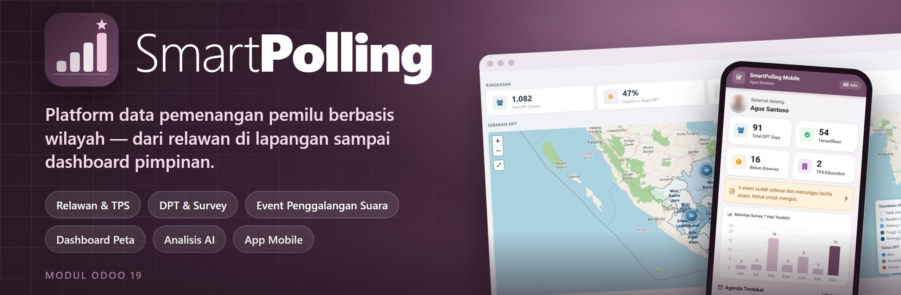
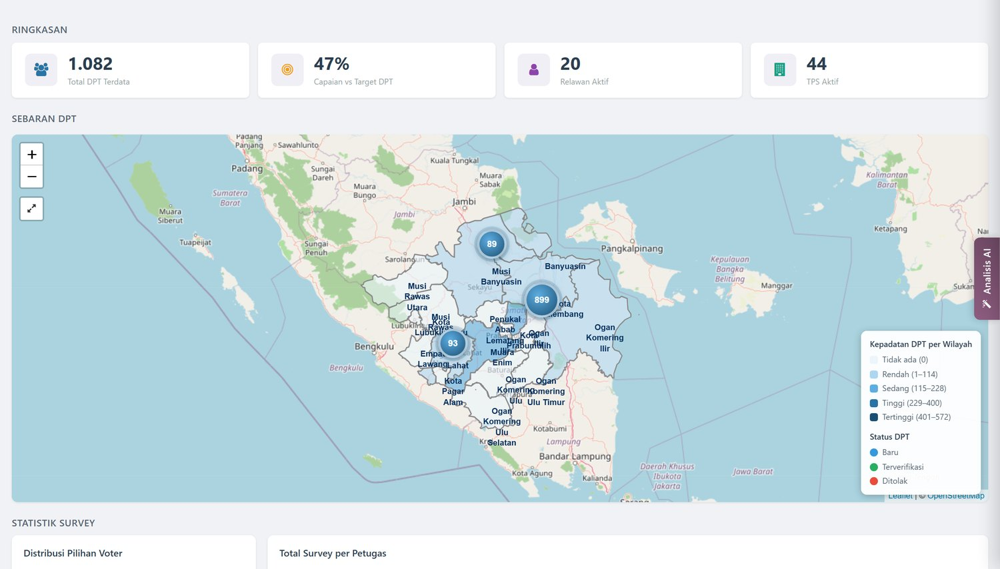
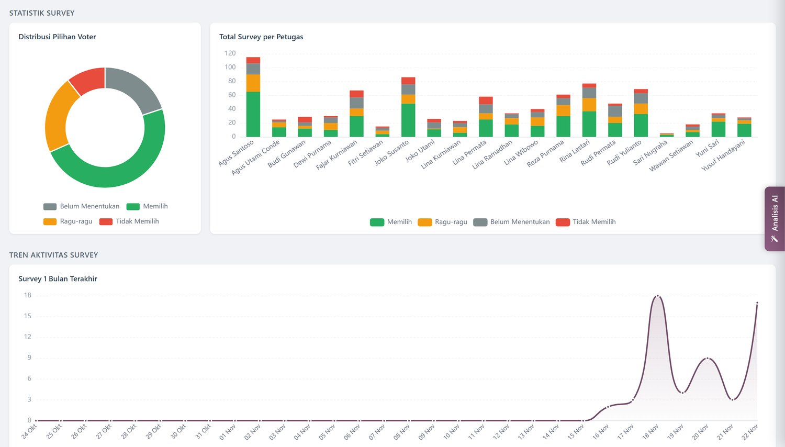
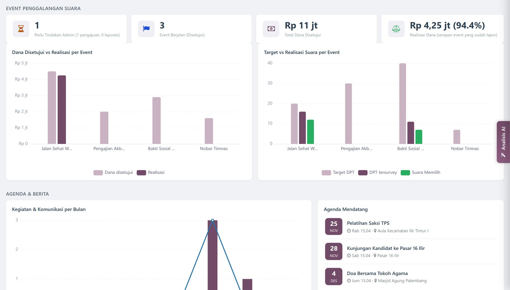
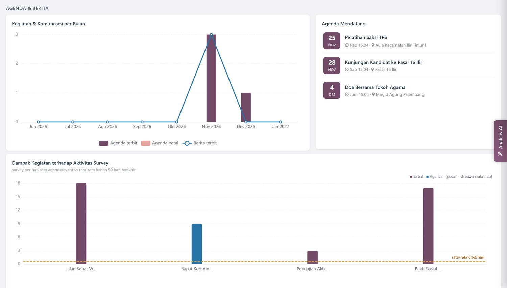
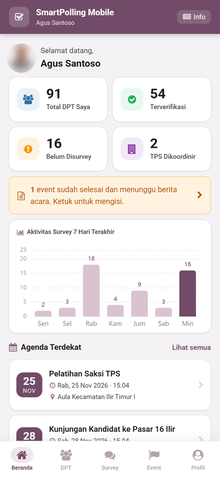
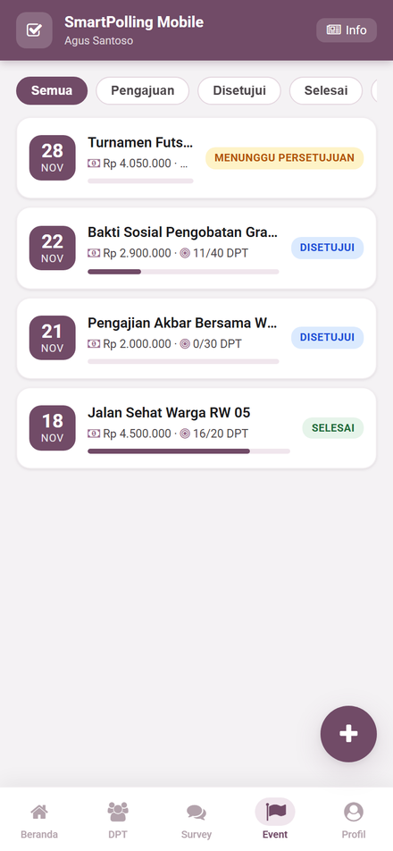
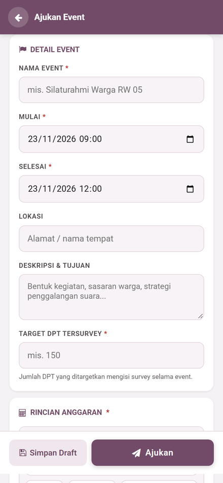
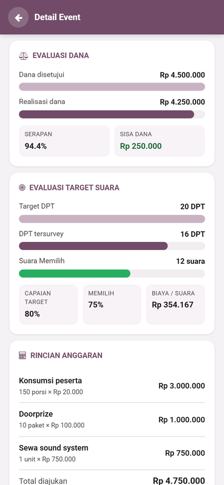

<p align="center">
  
</p>

# SmartPolling

Modul **Odoo 19** untuk manajemen data pemenangan pemilu berbasis wilayah: pendataan relawan, TPS, Daftar Pemilih Tetap (DPT), dan survey preferensi pemilih, lengkap dengan dashboard peta interaktif dan aplikasi mobile untuk relawan lapangan.

## Tampilan

### Dashboard (backend)

Satu halaman untuk memantau seluruh kondisi lapangan: KPI, peta sebaran DPT per wilayah, statistik survey, evaluasi event, dan agenda.

<table>
  <tr>
    <td width="50%"><br/><sub><b>Ringkasan & peta</b> — KPI, peta choropleth 3 level dengan drill-down, marker cluster DPT</sub></td>
    <td width="50%"><br/><sub><b>Statistik survey</b> — distribusi pilihan voter, survey per petugas, tren aktivitas</sub></td>
  </tr>
  <tr>
    <td width="50%"><br/><sub><b>Evaluasi event</b> — dana disetujui vs realisasi, target vs realisasi suara per event</sub></td>
    <td width="50%"><br/><sub><b>Agenda & berita</b> — kegiatan per bulan, agenda mendatang, dampak terhadap survey</sub></td>
  </tr>
</table>

### App Mobile Relawan (`/mobile`)

Dipakai relawan di lapangan lewat browser HP — tanpa perlu install dari app store.

<table>
  <tr>
    <td width="25%"><br/><sub><b>Beranda</b> — KPI pribadi, pengingat berita acara, aktivitas 7 hari, agenda terdekat</sub></td>
    <td width="25%"><br/><sub><b>Event</b> — pengajuan dan statusnya</sub></td>
    <td width="25%"><br/><sub><b>Ajukan event</b> — detail, target DPT, rincian anggaran</sub></td>
    <td width="25%"><br/><sub><b>Evaluasi</b> — anggaran vs realisasi, target vs suara</sub></td>
  </tr>
</table>

> Tangkapan layar memakai data demo; foto profil sudah dikaburkan.

## Fitur

- **Data Wilayah** — hierarki Kabupaten/Kota → Kecamatan → Desa/Kelurahan dengan geometri GeoJSON.
- **Relawan** — data relawan lapangan (nama, HP, alamat, foto, status), plus wizard **Buat User** untuk membuatkan akun login.
- **TPS** — Tempat Pemungutan Suara per desa, dengan koordinator relawan serta target vs realisasi jumlah DPT.
- **DPT** — biodata pemilih (NIK unik), koordinat GPS yang bisa diatur lewat peta Leaflet (drag marker), dan status verifikasi.
- **Survey (Voter)** — riwayat kunjungan survey preferensi per DPT (memilih / ragu-ragu / belum menentukan / tidak memilih) dengan foto dokumentasi; tiap survey otomatis tercatat di chatter DPT.
- **Dashboard** — KPI ringkas, peta choropleth 3 level dengan drill-down dan marker cluster titik DPT, grafik ECharts (distribusi pilihan, survey per petugas, tren 30 hari), seksi **Event** (dana disetujui vs realisasi, target vs realisasi suara), seksi **Agenda & Berita** (kegiatan per bulan, agenda mendatang), dan **Dampak Kegiatan** (survey per hari saat agenda/event vs rata-rata harian).
- **Analisis AI (Gemini)** — panel di dashboard yang membuat laporan analisis terstruktur (status, temuan kunci, wilayah prioritas, evaluasi event, rekomendasi) untuk seluruh wilayah atau per kabupaten, periode 7/30/90 hari. Hanya angka agregat yang dikirim ke AI — tanpa NIK, nama pemilih, atau nama relawan. Riwayat analisis tersimpan beserta data yang dianalisis. API key diatur di **SmartPolling → Konfigurasi → Pengaturan AI** (administrator sistem).
- **Berita & Agenda** — admin menulis berita (dengan gambar sampul, bisa disematkan) dan agenda kegiatan (waktu, lokasi, bisa dibatalkan) di backend; setelah diterbitkan, langsung tampil di app petugas.
- **Event Penggalangan Suara** — petugas mengajukan event (detail, rincian anggaran, target DPT tersurvey) dari app; admin pusat menyetujui & menetapkan dana, menolak, atau minta revisi. Selama event, survey bisa ditandai untuk event tersebut. Setelah event, PIC mengirim berita acara (ringkasan, foto kegiatan, rincian penggunaan dana + foto nota). Hasil akhirnya **evaluasi**: anggaran vs realisasi dana (serapan, sisa/lebih bayar) dan target vs realisasi suara (DPT tersurvey, suara Memilih, biaya per suara) — per event di app & backend, serta lintas event lewat list/pivot.
- **App Mobile Relawan** (`/mobile`) — aplikasi web mobile-first berbasis Owl: beranda KPI + agenda terdekat + berita terbaru, input DPT dengan GPS, input survey dengan kompresi foto, tab Event (pengajuan, berita acara, evaluasi), halaman Info (berita & agenda), dan profil.

## Hak Akses

| Grup | Akses |
|---|---|
| Administrator | Penuh atas semua data, termasuk membuat akun relawan, verifikasi DPT, menerbitkan berita & agenda, serta menyetujui/menolak pendanaan event dan memverifikasi berita acara |
| Relawan | User **Portal** — hanya app `/mobile`, tidak bisa masuk backend. Data DPT/Survey dalam cakupannya sendiri, TPS yang dikoordinasi (baca saja), berita & agenda yang sudah terbit (baca saja), event miliknya sendiri (ajukan, lapor) |
| Dashboard Viewer | Baca seluruh data operasional, termasuk event & evaluasinya; berita & agenda yang sudah terbit |

Cakupan relawan ditentukan oleh field **Relawan Terkait** (`relawan_id`) pada user.

## Kebutuhan

- Odoo 19.0
- Dependensi modul: `base`, `web`, `mail`

Library frontend (Leaflet, Leaflet.markercluster, ECharts, Font Awesome) sudah disertakan di `static/lib/`.

## Instalasi

1. Salin folder `smartpolling` ke salah satu direktori `addons_path` Odoo Anda.
2. Install modul:
   ```bash
   python odoo-bin -c odoo.conf -d <nama_db> -i smartpolling
   ```
   atau lewat **Apps → Update Apps List → cari "SmartPolling" → Install**.
3. Atur grup pengguna di **Settings → Users** (kategori *SmartPolling*). Untuk relawan, gunakan tombol **Buat User** di form Relawan agar akun langsung terhubung.

Data wilayah (kabupaten/kecamatan/desa beserta GeoJSON) **tidak** disertakan dalam modul dan perlu diisi sendiri sesuai wilayah yang digunakan.

## Penggunaan

- **Backend**: menu **SmartPolling** → Dashboard · Wilayah & Tim (Kabupaten/Kota, Kecamatan, Desa/Kelurahan, TPS, Relawan) · Pemilih (DPT, Survey) · Kegiatan (Event, Menunggu Persetujuan, Agenda, Berita) · Konfigurasi (Pengaturan AI, khusus administrator sistem). **Kegiatan → Menunggu Persetujuan** langsung menampilkan pengajuan dana dan berita acara yang menunggu keputusan admin.
- **App mobile relawan**: buka `http://<host>:8069/mobile` dan login dengan akun relawan (user harus memiliki *Relawan Terkait*).

## Pengujian

```bash
python odoo-bin -c odoo.conf -d <nama_db> --test-tags smartpolling --stop-after-init --http-port=8099
```

Test UI app mobile memerlukan Google Chrome dan paket Python `websocket-client`; tanpa keduanya test tersebut dilewati (skip).

## Struktur

```
smartpolling/
├── controllers/   # route & API app mobile relawan, redirect login petugas
├── docs/          # tangkapan layar untuk README
├── data/          # sequence kode TPS
├── migrations/    # skrip migrasi antar versi
├── models/        # wilayah, relawan, tps, dpt, voter, berita, agenda, event, res.users, wizard
├── security/      # grup, record rule, access rights
├── static/        # dashboard, widget peta, app mobile, vendor libs
├── tests/         # test model, API, dan UI app mobile
└── views/         # form/list/kanban/pivot/graph/calendar, menu, template mobile
```

## Lisensi

LGPL-3 — © CV Sel Studio
